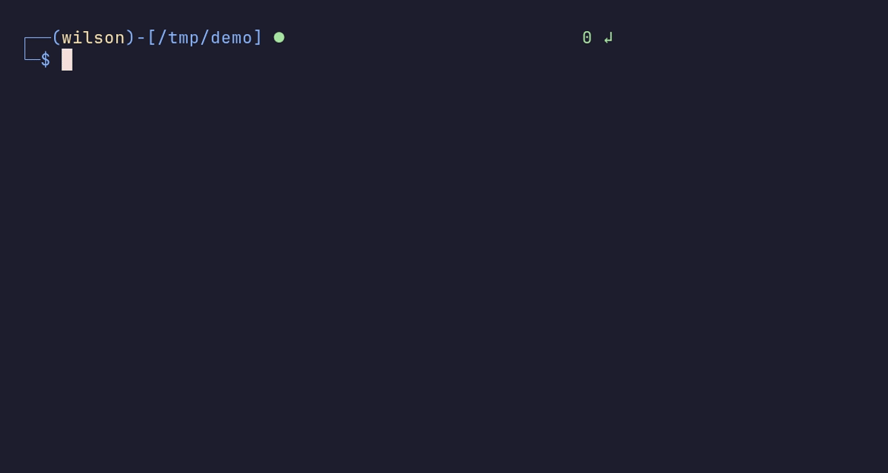

<div align="center">

# 42sh

**Un shell Unix inspiré de tcsh, écrit en C à quatre.**

  

<sub>Projet à 4 · 2023</sub>

</div>

<br/>

<p align="center"></p>

## Le projet en quelques mots

Le projet de fin de première année. On réutilise tout ce qu'on a appris en programmation système pour écrire un shell qu'on peut utiliser au quotidien : pipes, redirections, variables, historique… et un prompt qui donne envie de s'en servir.

## Ce que ça fait

- Pipes `|`, séparateur `;` et redirections `>`, `>>`, `<`, `<<`
- Globbing : `*`, `?`, `[...]`
- Variables d'environnement dans les commandes (`echo $USER`)
- Builtins : `cd` (et `cd -`), `echo`, `env`, `setenv`, `unsetenv`, `history`, `exit`
- **Historique** persistant et horodaté, navigation aux flèches
- **Prompt** coloré avec utilisateur, dossier courant et code de retour de la dernière commande, adapté à la largeur du terminal

## Lancer le projet

```bash
make
./42sh
```

## L'équipe

<a href="https://github.com/Wilson-Epitech/42sh/graphs/contributors"></a>

Mathis Brehm, Yanis Harkouk, Wilson Bordichon, Eva Legrand

**Ma partition :** J'ai fait l'**historique** (commande `history`, fichier persistant, horodatage), le **prompt** dynamique et coloré, les options `--help` / `--list-op`, et corrigé la redirection `<<` ainsi que le comportement du shell quand on supprime `PATH`.
